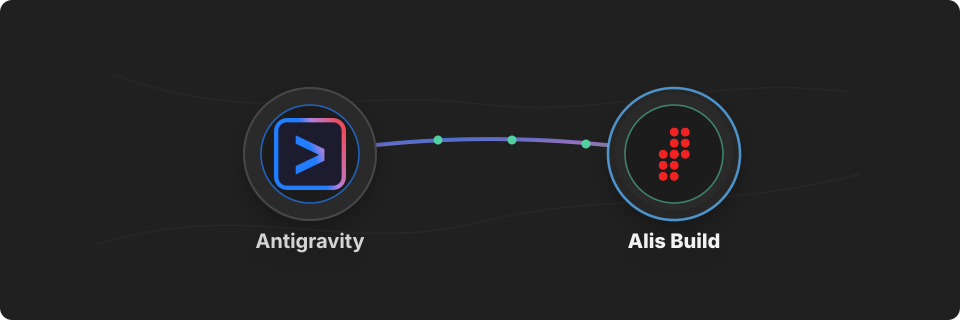

# Alis Build Antigravity Plugin

<p align="center">
  
</p>

<p align="center">
  <strong>Connect Google Antigravity to Alis Build.</strong>
</p>

Use this plugin to let Google Antigravity work with build environments, products, services, builds, and deploys through the `alis` CLI, with workspace-aware context injected before the model runs.

## What You Get

- A workspace-aware Define-Build-Deploy primer: the full guide once, at the start of a conversation inside an `alis.build` workspace, and a short refresher that is always in context as a plugin rule (`rules/alis-build.md`). `ALIS_PRIMER=full` gives the full guide outside a workspace too; `off` or `digest` gives only the refresher.
- Package ids and pointers between a service's protobuf definitions and implementation, including when a mounted workspace is inside `infra/` or `.playground/`; multiple mounted workspaces are supported.
- Quiet, local-first discovery and capture skills: `alis-discover` activates on platform-shaped work (never on generic coding just because you are inside a workspace), probes the local catalogue in ~40ms, and loads a registry skill only on a distinctive match; `alis-capture` turns just-completed work into a reusable team skill; `alis-getting-started` walks newcomers through their first Define-Build-Deploy cycle
- A skill the Skill store ranks as a match for your request is noted beside the prompt, so the agent can load it: one skill at most, and nothing when no skill fits. The note stays in the conversation, and the agent names the skill even when it answers without loading it.
- Four topic rules the agent reads when the work calls for them: protobuf contracts, a service's `infra/` Terraform, the playground, and dependency pins. Only their one-line descriptions sit in context until then.
- `alis` commands carry the conversation id and the plugin version (`--session-id`, `--client-plugin`), so a skill load or a build is attributed to the session it came from. Antigravity notes on the tool result that the hook changed the command. Needs `alis` 1.187.18 or later. It costs each prompt most of a second and sends the prompt text to the Skill store; set `ALIS_SUGGEST_ALWAYS=0` to switch it off.
- A quiet background catalogue refresh at the start of a conversation, explicitly using `alis skills sync --cache-only --harness antigravity` for compatibility with older CLIs. The plugin never installs native user skills; the CLI may clean up retired sync-managed entries.
- A native tool hook that lets plain `alis …` commands run without a confirmation prompt on every call, while `--confirm-production` (the production deploy gate), `--approve`, and `alis blocks uninstall … --yes` always reach you for confirmation.

## Before You Start

You need:

- Google Antigravity installed (from [antigravity.google](https://antigravity.google))
- The [`alis` CLI](https://alis.build) installed, on your `PATH`, and signed in (`alis login`)
- Bash and `jq` on Antigravity's `PATH` (context and permission hooks skip quietly if `jq` is missing; an existing handoff claim still pauses local work)
- An Alis Build account with access to the build environments and products you want to use

## Install

Install the plugin:

```sh
agy plugin install https://github.com/alis-build/antigravity-plugin
```

Or copy manually:

```sh
git clone https://github.com/alis-build/antigravity-plugin
mkdir -p ~/.gemini/config/plugins
cp -R antigravity-plugin ~/.gemini/config/plugins/alis
```

Restart Antigravity after installing.

## Use It

Ask Antigravity to use Alis Build — just describe what you want:

```text
build it
```

```text
fix it
```

```text
Use Alis Build to list the build environments I can access.
```

```text
Show recent builds for product os in build environment alis.
```

```text
Review the latest deploy logs for this service and suggest the next action.
```

Antigravity will ask before running tools that require approval.

The plugin's `PreToolUse` hook answers `auto_approve` for single, simple `alis ...` commands (including balanced single/double-quoted JSON or query arguments and leading global flags like `--cwd`), as well as same-org `build`/`define` file and search tools. Commands with shell expansion, chaining or redirection fall through to Antigravity's normal confirmation flow. Commands carrying `--confirm-production` or `--approve`, and `alis blocks uninstall … --yes`, return `force_ask`, which prompts even when permissions were previously cached. To restrict auto-approval, set `ALIS_ALLOWED_SUBCMDS` to a space-separated list (e.g. `ALIS_ALLOWED_SUBCMDS="define build deploy operations"`); unset means every subcommand.

## Skills

Discovery is skill-native: describe platform-shaped work in your own words and the `alis-discover` skill routes it — local catalogue probe first, registry skill loaded only on a distinctive match, silence otherwise. Say "capture this as a skill" after solving something new and `alis-capture` saves it for your team.

The `frontend-preview` skill shows a service's web frontend in the browser the agent's own tools drive and checks it there: `alis preview --json` for the address, then Antigravity's browser in the IDE, `agent-browser` on a workstation (attached to the shell's shared Chrome), or a Playwright MCP to inspect, click and read the console. The CLI installs and launches nothing. Never used for logs or operation status.

## Hooks and primer sync

`context/dbd-primer.md` and `context/dbd-digest.md` are synced from the Claude Code plugin (`claude-plugin/plugins/alis-build/context/`, v0.23.0), with skill names adapted to `alis-discover` / `alis-capture`. Sync these files and the Gemini compatibility primer body together on each canonical primer release.

Antigravity uses a root-level `hooks.json` with named hooks, camelCase inputs and JSON outputs. Commands run relative to that file, so workspace detection uses `workspacePaths` from the payload. These contracts are described in the [Antigravity plugin guide](https://antigravity.google/docs/plugins/) and [hook reference](https://antigravity.google/docs/hooks).

| Claude behaviour | Antigravity adaptation |
| --- | --- |
| `SessionStart` primer and service context | `SessionStart` returns `injectSteps` with a `systemMessage`, which stays for the whole conversation. The short refresher is an `always_on` rule, so nothing is re-injected per model call. |
| Startup catalogue refresh | `SessionStart` launches `sync --cache-only --harness antigravity` with all streams detached. Unsupported flags fail quietly, with no fallback to a broader sync. |
| `UserPromptSubmit` skill suggestions | `PreInvocation` carries the most recent prompt as `lastUserInput`. `hooks/suggest-skills.sh` passes it to `alis skills suggest --hook` once per prompt and returns a Skill store match as a `systemMessage`; the CLI's local guesses are dropped, as in the Claude plugin. Native discovery/capture skills still handle routing the agent starts itself. |
| `PreToolUse` on `Bash` | `PreToolUse` on `run_command` and file/search tools reads `toolCall.args` and returns `auto_approve` or `force_ask`. (`allow` only passes the call on to the default policy, which then prompts.) An approved command gets `overwrite` with `--session-id` and `--client-plugin` appended, when the CLI answers `alis hooks capabilities`. |

Three facts about Antigravity's hooks shape this, each checked against a real `agy` (1.5.5):

- `PreInvocation` fires before every model call, not once per prompt. Only the skill suggestion runs there, and it asks once per prompt.
- An `ephemeralMessage` lasts for one model call. A `systemMessage` from `SessionStart` stays, so start-of-conversation context is given that way.
- Glob-triggered rules never activated, from a plugin or from a workspace, on reading or editing a matching file. `model_decision` rules do: the topic rules use that trigger.
- Each start-of-conversation hook is also registered on `PreInvocation` for an Antigravity that does not fire `SessionStart`: it leaves a marker at `SessionStart` and stands down when it finds one.

`ALIS_PRIMER=off` disables the full primer; the refresher rule, service pointers and catalogue refresh remain independent. No Claude permission-mode record is written: Antigravity does not supply that grant signal.

`gemini-extension.json`, `gemini/GEMINI.md`, and `policies/alis-cli.toml` remain for Gemini CLI compatibility. Gemini extension installs retain the standing full primer and shell policies; native Antigravity plugin installs use the root hook configuration above.

## Validation

```sh
bash tests/validate.sh
```

This checks manifests, shell syntax, Antigravity's own `agy plugin validate --strict` when `agy` is installed, primer consistency and native hook behaviour with a fake CLI, including workspace gating, service paths, detached catalogue refresh and permission boundaries. Tests do not contact Alis Build or modify installed skills.

## Conversation reading and package setup

Read referenced conversations before proposing changes: use
`alis specialist get tickets/ID --json`, or find the title with
`alis specialist tickets --state all --json`. Use `alis packages install`
for private package setup during Build. Read command results and help in full.

If this guidance is absent after updating, confirm the Alis plugin is enabled
and restart the agent. The CLI alone does not activate the agent plugin.
For immediate guidance, read `alis docs specialist` and
`alis packages install --help`.

## Troubleshooting

The plugin uses native hook protocol 1 in the `alis` binary. Upgrade the CLI
first with `alis upgrade`; `alis hooks capabilities` must report `"protocol":1`.
Restart the coding agent after updating. Python is not a runtime dependency.
Older CLIs receive one startup upgrade notice; optional native checks wait for
the upgrade, and existing handoff claims remain fenced by the compatibility
adapter. Bash and `jq` are still used by the other plugin hooks.

If the primer or skills do not take effect, confirm the plugin appears in Antigravity's Customizations page and restart it. For a manual global install, check `~/.gemini/config/plugins/alis/`. Confirm `jq` and `alis` are on the application's `PATH`, and that `ALIS_PRIMER` is not set to `off`.

If `alis` commands fail with an auth error, run `alis login` (or `alis authorise <org>.<product>` for git/package credentials) and retry.

## Workstation handoff and Claude parity

Shared CLI guidance is synced with [Claude plugin v0.23.0](https://github.com/alis-build/claude-plugin/commit/2cb12b52d2d74c642f58ccd5bee58cd12b9dacfe):
standalone commands, environment discovery without variable values, asynchronous
operations, complete JSON results, logs/cancellation and pinned production approval.
Native hook payloads and permission mechanisms remain specific to this agent.

Handoff opens the continuation in herdr, grouped by dotted dimensions: space
`alis.os`, tab `cli.v1`, with a separate pane and paired build/Define worktrees
for each session. The independent progress window must report `safe_to_close`
before the laptop closes; a terminal being open is not agent acceptance.

Antigravity uses an explicitly chosen summary fallback in this release. It starts
a new session with continuation context; native cross-machine resume is not
advertised. Hooks register the CLI session, enforce the source claim, and
acknowledge the destination. Unknown background inventory blocks transfer.

Requires the matching CLI, workstation runtime and agent integration on both
machines, enrolled SSH and independent destination authentication. Use
`alis workstation handoff status <id> --watch --json`, `open <id>`, or `cancel <id>`.
Preserve exact Alis operation IDs and continue monitoring them rather than
restarting a Define, Build or Deploy. Original local files and history remain.

## Native hook development checks

Run `ALIS_TEST_CLI=/absolute/path/to/alis-dev python3 -B tests/test_native_hooks.py`
to check the bridges against a built CLI with Python absent from the hook PATH.
Python is only a development test runner. Native handler tests live in the CLI.
